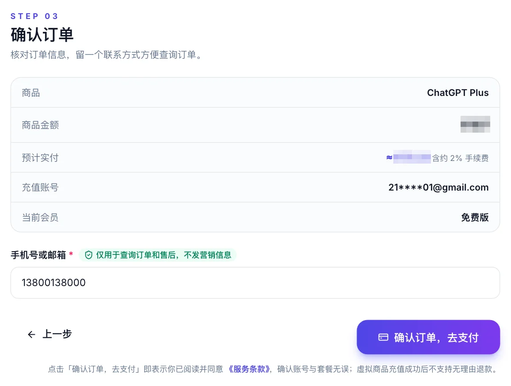
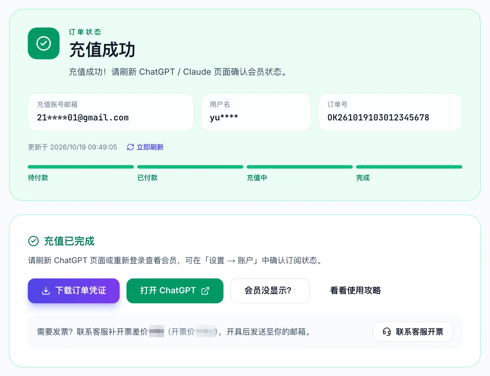
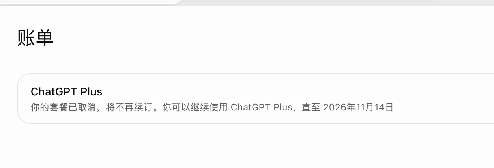

# 电脑怎么开通 ChatGPT Plus？2026 网页版开通步骤（官网 vs 支付宝微信）

> 最后更新：2026 年 10 月 20 日 · 本页讲电脑端操作。手机端见 [iPhone 开通](../iphone/)，三条路径的总体对比见 [开通教程总览](../)。

电脑网页版是开通 ChatGPT Plus 最顺手的环境：屏幕大、能开多个标签页、扫码付款方便。在电脑上开通只有两条路：**有海外信用卡**，点官网左下角「升级」直接付；**没有海外卡**，在同一个浏览器里走代充，支付宝 / 微信扫码付款。Windows 和 Mac 没有任何区别，用的都是浏览器。

## 先选浏览器，关掉会改网页的插件

不管走哪条路，开始前先把浏览器环境弄干净。这一步省不得，很多「付款后没反应」「会话信息复制出来是空的」都出在这里。

| 项目 | 建议 | 原因 |
|---|---|---|
| 浏览器 | Chrome 或 Edge | 兼容性最好，官网结算页和代充校验都在这两个上验证过 |
| 插件 | 暂时关闭翻译、广告拦截、脚本修改类插件 | 它们会改动网页内容，导致结算页加载不全或会话信息页显示异常 |
| 登录账号 | 浏览器里只登录一个 ChatGPT 账号 | 多账号同时登录时，复制的会话信息可能对应到另一个账号 |
| 隐身窗口 | 不建议 | 隐身窗口关闭即失去登录状态，付款后刷新确认会麻烦 |

> [!TIP]
> 最省事的做法：新开一个 Chrome 用户配置文件（右上角头像 → 添加），里面不装任何插件，只用来登录 ChatGPT 和开通。

## 路径一：官网「升级」按钮（需要海外信用卡）

1. 登录 chatgpt.com，点左下角账号菜单里的「升级套餐」或对话框上方的「升级」。
2. 选 Plus，进入结算页。结算由 Stripe 处理，页面是英文。
3. 填卡号、有效期、CVC、账单地址。**账单地址要和发卡行记录一致**，这是被拒的第二大原因（第一是卡本身是国内发行）。
4. 提交，部分卡会跳转银行做 3DS 验证。
5. 成功后自动回到 ChatGPT，左下角立即显示 Plus。

国内发行的 Visa / Mastercard 双币卡、虚拟卡在这一步大概率被拒，不是你操作错了，是 OpenAI 的支付风控。被拒的具体报错和处理见 [订阅百科的付款失败排查](https://imi0801.github.io/chatgpt-plus-guide/chatgpt-payment-declined/)。如果试了两次都不过，别再刷了，反复失败会让后续尝试更难，直接看路径二。

## 路径二：支付宝 / 微信扫码（不需要海外卡）

这条路不用官网的升级按钮，升级按钮灰色或不显示也能走。核心是：在代充平台下单，平台把 Plus 开到你的账号上。

### 1. 开两个标签页

标签页 A：登录 chatgpt.com 的你要开通的账号。标签页 B：打开 [OKAI66](https://okai66.com/)，选 ChatGPT Plus，点「立即充值」。

### 2. 复制会话信息

在标签页 A 所在的**同一个浏览器**里再开一个标签页，地址栏输入 `chatgpt.com/api/auth/session` 回车。页面会显示一段文本，Ctrl + A（Mac 是 Cmd + A）全选，Ctrl + C 复制。

这段文本不含密码，只用来让平台识别「开到哪个账号」。如果页面显示的内容很短或者是一对空括号，说明这个浏览器没有登录状态，回标签页 A 确认已登录后再试。

### 3. 粘贴、核对邮箱

回到标签页 B，粘贴。系统自动校验，显示账号邮箱和当前套餐。对一下邮箱是不是你要开的那个。

### 4. 确认订单，扫码付款

填手机号或邮箱（查订单用），确认订单，选支付宝或微信。电脑上会显示二维码，用手机的支付宝或微信扫码付款。

在线支付有 2% 的通道手续费，加客服微信开通可以免。

### 5. 等待自动到账，刷新确认

付款后不用做任何事，订单页状态「已付款 → 充值中 → 完成」。完成后回到标签页 A 刷新（F5 或 Cmd + R）。

**👉 [电脑扫码开通 ChatGPT Plus → okai66.com（支付宝 / 微信，不要密码）](https://okai66.com/)**

## 开通后在电脑上怎么确认

刷新后看三处：

1. 左下角账号菜单显示 Plus，「升级」按钮消失。
2. 设置 → 账单，显示 Plus 和到期日。

3. 对话框上方的模型选择器能选到 Plus 档的模型。

刷新没变化就退出账号重新登录一次，这是最可靠的刷新方式。桌面客户端（Windows / Mac 的 ChatGPT App）用的是同一账号，网页确认生效后，客户端重启即可同步。

> [!WARNING]
> 代充开通后账单页显示「套餐已取消，将不再续订」是正常的，意思是不会自动扣款。到期前回来再充一次，详见 [续费 / 到期说明](https://imi0801.github.io/chatgpt-plus-recharge-guide/renew/)。

## 常见问题 FAQ

### Q：电脑上开通 ChatGPT Plus 和手机上有区别吗？

权益没有区别，Plus 绑定账号不绑设备。电脑上操作更方便：能同时开标签页复制会话信息、扫码付款；iPhone 上的差异见 [iPhone 开通](../iphone/)。

### Q：官网「升级」按钮是灰色的，电脑上还能开通吗？

能。升级按钮灰色只说明官方结算入口对你的地区 / 网络不开放，走路径二不依赖这个按钮。原因和其它处理见 [开通失败怎么办](../failed/)。

### Q：chatgpt.com/api/auth/session 打开是空的怎么办？

说明当前浏览器没有登录状态。回 chatgpt.com 确认已登录你要开的账号，再在同一个浏览器重新打开这个地址。换了浏览器或用了隐身窗口都会导致为空。

### Q：Mac 上用 Safari 可以吗？

可以，步骤一样。但 Safari 对某些结算页兼容性略差，遇到页面显示不全优先换 Chrome 再试。

### Q：电脑没有微信 / 支付宝客户端，怎么付？

不需要电脑端客户端。电脑页面显示二维码，用手机的支付宝或微信扫码就行。

### Q：付款后电脑上刷新还是 Free？

先退出账号重新登录；再核对订单页的邮箱和你登录的账号是否一致。订单显示「完成」但账号没变化超过 10 分钟，拿订单号联系平台售后。

## 一句话总结

电脑上开通 ChatGPT Plus：先把浏览器弄干净，有海外卡点官网升级，没有就在同一浏览器复制会话信息、在代充平台扫码付款，3 分钟后刷新即是 Plus。

**👉 [okai66.com — 电脑扫码，支付宝 / 微信开通 ChatGPT Plus / Pro](https://okai66.com/)**

## 相关页面

- [ChatGPT Plus 怎么开通？2026 国内开通教程（总览）](../)
- [ChatGPT 账号注册 2026](../register/)
- [iPhone 怎么开通 ChatGPT Plus](../iphone/)
- [ChatGPT Plus 开通失败怎么办](../failed/)
- [ChatGPT 付款失败、银行卡被拒怎么排查](https://imi0801.github.io/chatgpt-plus-guide/chatgpt-payment-declined/)
- [ChatGPT 充值教程：支付宝、微信、价格、到账](https://imi0801.github.io/chatgpt-guide/)

## 关于本文

- 本文作者与 [OKAI66](https://okai66.com/) 存在商业关系，该平台提供 ChatGPT / Claude 订阅的付费充值服务；路径二的截图来自该平台，请结合自身情况判断。
- 本站与 OpenAI、Apple 均无隶属关系。价格以 OpenAI 官网和平台实时显示为准。
- 内容按 CC BY-NC-SA 4.0 许可，转载请注明出处。
